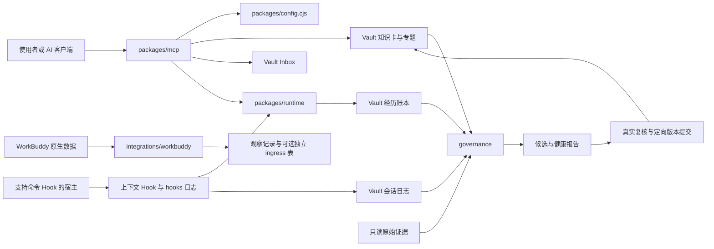

# 架构、模块职责与核心逻辑

系统围绕一个使用者指定的 Vault 工作。Markdown 保存可阅读的知识，账本保存可追溯的经历，MCP 和 Hook 是接入入口，治理脚本读取这些记录并生成待复核的候选与报告。

## 模块关系

复核后的知识回写由调用者组织。图中的知识循环不表示 Python 程序会自主调用模型、改写规则或调度夜间业务。

## 代码目录与生产文件

| 位置 | 职责、输入/输出和依赖 |
| --- | --- |
| `packages/config.cjs` | 从仓库位置和环境变量解析 Vault、Runtime、Codex Home；提供 `resolveWithinVault`，对 MCP 和账本的数据路径拒绝越界及库内部链接。ESM 与 CommonJS 共用同一配置实现。 |
| `packages/mcp/index.js` | 注册 stdio MCP 服务、11 个工具、2 个资源与一个 prompt；使用 Zod 校验请求，调用 `lib.js` 或 Runtime，返回文本及结构化结果。 |
| `packages/mcp/lib.js` | 知识数据模块：Markdown/YAML 解析、检索评分、读取、状态、核心上下文、Inbox 去重和知识卡更新。依赖 `config.cjs`、`yaml` 与 Node 文件接口。 |
| `packages/mcp/hook.js` | 将 `SessionStart` / `SubagentStart` / `UserPromptSubmit` / `Stop` 转成上下文或经历事件。解析 stdin JSON，用宿主身份派生幂等任务标识并连接 Runtime。 |
| `packages/mcp/smoke.js` | 用 SDK 的真实 stdio 客户端启动服务子进程，列出工具/资源、读取核心资源并执行检索和状态调用。 |
| `packages/runtime/runtime.mjs` | 文件锁、脱敏、类型保持、哈希链、任务开始/结束幂等、事件归一、超时管理闭环、经历召回与候选行动评分。只写 Vault 下的经历运行区。 |
| `hooks/second-brain-log.cjs` | 接收明确输入与最终输出事件；必要时读取允许位置的 transcript 尾部；区分真实回合、拒绝用过程消息替代终态、去重并写按日 Markdown。 |
| `hooks/second-brain-transcript-sync.mjs` | 单次扫描 Codex `sessions` 的 JSONL，按文件游标增量同步新消息；第一次为已有文件建立尾部基线，后续调用才追加。独立锁与游标位于本地状态区。 |
| `hooks/recover_codex_day.cjs` | 对显式指定 transcript 和日期生成补回预览；只有 `--apply` 才交给日志模块写入，保留原始回合身份与北京时间日期。 |
| `governance/self_growing_distillation.py` | 数据面 Markdown 的增量状态、敏感资格检查、复核清单、内容候选排序与经历蒸馏。默认生成候选报告和状态，`--dry-run` 只预览。 |
| `governance/health_gate_policy.py` | 校验显式关键卡注册表、阶段与每轮依赖路径，拒绝重复/无效注册和重解析路径，返回解析后的 Vault 根、策略哈希及本轮关键路径；健康脚本沿用该根计算相对路径。 |
| `governance/知识健康检查.ps1` | 调用前述 Python 资格门与健康策略；对同一批文件字节核验哈希，再检查属性、来源、链接、日期和关键卡；输出真实健康指标或报告。 |
| `integrations/workbuddy/resolve_second_brain_run_context.py` | 从只读 SQLite 运行记录和排程解析任务类型及目标日期，约束身份、时钟、任务年龄、周日流程与迟到范围。 |
| `integrations/workbuddy/validate_automation_receipt.py` | 校验机器回执的步骤顺序、状态、相邻证据、最终 ACTION 与业务字段；同时提供结构化宿主终态提取函数。 |
| `integrations/workbuddy/audit_second_brain_terminal.py` | 只读关联运行记录与原生 transcript，确认 session/request 身份、最终 assistant 消息、输出一致和回执格式；报告原生证据状态。 |
| `integrations/workbuddy/workbuddy_terminal_observer.py` | 观察真实 `FinalStop`，校验当前活跃运行与 transcript 后独占创建不可覆盖的观察记录；完成后可以重新读回验证。 |
| `integrations/workbuddy/workbuddy_terminal_ingress.py` | 可选的独立证据表写入与回读。绑定实现/Hook 哈希、启用时间与活跃运行，拒绝重放、敏感回执及配置漂移；保持宿主结果与正式门字段。 |
| `integrations/workbuddy/run_second_brain_health_check.py` | 以 `-NoWrite` 调用健康脚本，解析完整指标并交叉核对，输出 `second-brain-health-check-v2` 的 PASS/HOLD；供其他调用者复用。 |
| `scripts/reconcile_second_brain_ledger.mjs` | 使用 Runtime 审计开放任务；显式 dry-run 或 apply，限制本轮数量、支持排除项、回读确认旧前缀完整和追加结论。 |
| `scripts/inbox/Save-ClipboardToInbox.ps1` | 从显式 `-Text` 或用户调用时的剪贴板收件，脱敏、生成 UTF-8 Markdown；以独占文件名保留现有收件。 |
| `scripts/inbox/Invoke-InboxPipeline.ps1` | 显式 Enqueue / Process / Retry / Status 管线，绑定输入哈希和路由依据；Process 默认预览，`-Apply` 才移动收件并保存请求/结果。 |
| `scripts/init-vault.mjs` | 向新目录复制通用模板，替换示例日期并创建必要目录，拒绝覆盖非空库；也可供程序直接调用。 |
| `scripts/demo.mjs` | 创建独立示例库，完成收件、知识、任务和回读断言；输出演示结果与保留的工件路径。 |
| `scripts/verify.mjs` | 发现并运行 Node 测试，顺序执行 Python 两组 unittest；任意失败以非零退出码结束。 |
| `scripts/check-release.mjs` | 检查当前提交候选的文件范围、凭据/私人路径形态、MIT 元数据、配置和本地 Markdown 链接；只输出发现位置和类型。 |
| `templates/vault/` | 重新编写的库骨架、三张通用核心卡、索引和关键卡策略。初始化后的数据由使用者管理。 |
| `examples/` | 可替换路径的 MCP / Hook 说明，以及使用真实客户端调用现有工具的入口。 |
| `tests/` 与各模块测试文件 | 跨目录入口、中文路径、初始化保护、链接隔离、收件路由及各模块的回归；输入全部为独立夹具。 |

本仓库采用一个根 `package.json` 和锁文件。MCP 与 Runtime 通过相对模块关系协作，Runtime 的可选替换路径由配置模块统一解析。Python 与 PowerShell 不额外安装业务依赖。

## MCP 接口

| 工具 | 主要输入 | 输出与写入 |
| --- | --- | --- |
| `second_brain_search` | `query`，可选 `scopes`、`limit` | 排序候选、摘要与相对路径；只读。默认 knowledge/topics，默认 5 条、最多 20 条。 |
| `second_brain_read` | `path`，可选 `maxChars` | 脱敏正文与 `truncated`；只读 Markdown，默认 20000 字符、上限 100000。 |
| `second_brain_core_context` | 无 | 紧凑核心上下文；只读。 |
| `second_brain_status` | 无 | 各可读 scope 的 Markdown 数量与最近修改时间；只读，不证明知识健康。 |
| `second_brain_capture` | `text`，可选 `source`、`title`、`sourceUrl` | 写 `00_Inbox/WorkBuddy`，返回相对路径、内容身份、去重结果和提交需求。 |
| `second_brain_upsert_card` | 标题、类型、状态、置信度、来源、标签、当前认知、证据 | 写 `02_Knowledge` 单卡；返回创建/更新与提交需求。 |
| `second_brain_task_start` | `taskId`、`goal`，可选任务类型、项目、授权描述、检索回执 | 追加任务开始记录；同一 taskId 幂等。 |
| `second_brain_record_event` | `taskId`、`eventType`、`event` | 追加脱敏事件；通用事件本身不默认去重。 |
| `second_brain_task_finish` | `taskId`、`outcome`、`reflection`，可选结果、验证和经验候选 | 追加结束记录；同一 taskId 幂等；验证字段由调用者提供。 |
| `second_brain_recall_experience` | 可选 query、任务类型、项目、结果、错误签名和 limit | 返回经历候选、证据标签、经验评审资格与召回回执；只读。 |
| `second_brain_score_candidates` | `candidates`，每项必须有 `safe: boolean` | 返回排序和 ELIGIBLE/HOLD；只读，不执行候选行动。 |

两个只读资源是 `second-brain://core` 和 `second-brain://index`；prompt 名称为 `second-brain`。完整字段、枚举与长度以 `index.js` 中的 Zod schema 为准。

写入工具的 `readOnlyHint`、`idempotentHint` 等字段是协议提示。授权须由客户端或接入程序单独实施；`authority` 文本仅用于记录上下文。

## 知识数据的核心逻辑

1. **读取**：允许指定知识区域和三个根规则文件；阻断隐藏路径、`..`、绝对路径、非 Markdown、大于 1 MiB 的文件以及库内部链接。
2. **检索**：将中文词拆成有限二字片段，累计标题/路径/正文命中分，再按 active/disputed/draft/retired 状态调节；按分数和修改时间排序。每个 scope 最多枚举 5000 个 Markdown。
3. **核心上下文**：从 `_知识索引.md` 的“第一层”和三张核心卡的“当前认知”提取紧凑内容。相关记忆注入仅保留前三个候选，并提示阅读全文。
4. **收件**：对脱敏后的 `source + text` 求哈希形成内容身份，在受管目录中查重，用 `wx` 独占写入新 Markdown；这只说明明确保留的文本已经落盘。
5. **回写**：保留已有 frontmatter 的其他字段和创建日期，更新当前认知、来源、标签、复核日期；同日同证据不重复追加时间线。知识写入日期采用 ISO UTC 日期。

MCP 的常见形态脱敏与 Python 的“隔离可疑来源”是不同能力。Python 资格门对正文、解码和人工复核哈希更严格；MCP 检索不会隐式调用整库健康检查。

## 经历账本的核心逻辑

账本位于 `05_Review/SecondBrainRuntime/episode-ledger.jsonl`，记录 schema、序号、task_id、事件类型、时间、脱敏 payload、前一条哈希与当前哈希。

- 追加前获得带进程身份的独占文件锁；过期且确认没有活进程的锁可隔离，活锁和不可判断的锁保持阻断。
- 读取完整旧链并验证序号/前向哈希后才能追加；普通事件名归入有限事件类型，原名留在 payload。
- 开始/结束事件按 taskId 幂等；Hook 用回合、session 和 prompt 的派生哈希处理重复投递与身份漂移。
- 超时管理只追加 `stale_unclosed / unverified` 结论，保留旧记录，不推断历史任务成功或失败。
- 召回以关键词和任务字段排序；证据标签取决于已记录的 verification 字段，真实性仍需检查外部工件。

经验进入 `eligible_for_review` 的结构门槛：同一错误签名至少包含两个来源、两个 verifier、两个不同 `artifactHash + runId` 的回执，并均声明真实回归通过。该门槛不会自动写知识卡，也不能自行证明声明者的独立性；调用者必须提供可信验证及可回读工件。

行动评分是本项目自定义的有限加权规则：`safe=false` 或错误/缺失安全字段直接 HOLD；合法维度只能取 0..1。高分不授予任何执行权限。

## 治理与原生证据

蒸馏先校验复核清单与数据资格，验证经历链，再比较内容基线、关联已有知识、排序候选并写报告/状态。候选是待处理材料，人工或接入模型的复核与知识提交由上层工作流承担。

分层健康门把结构、安全、关键卡与真实依赖保留为硬阻断；普通卡真实逾期保留提醒。包装器必须同时确认指标完整、内部一致、原生退出码为 0、stderr 为空且硬问题为 0，才返回 PASS。

WorkBuddy 适配器关联原生 run/session/request、终态文本和不可覆盖观察记录。独立 ingress 写入仅保存证据，`official_gate_upgraded` 与 `complete_repair_proven` 保持 false。其数据库前提、schema 与状态含义见 [WorkBuddy 说明](../integrations/workbuddy/README.md)。
